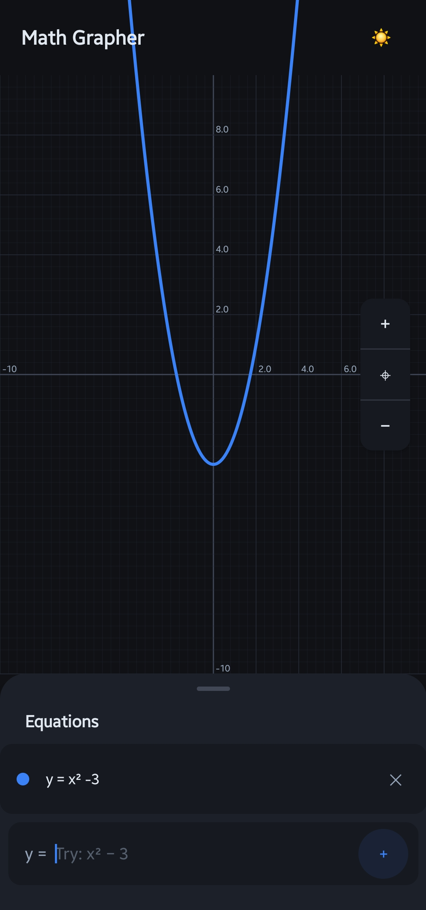
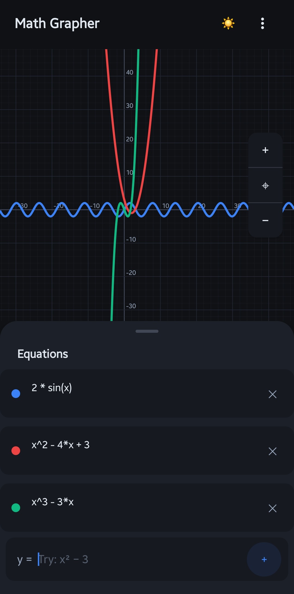
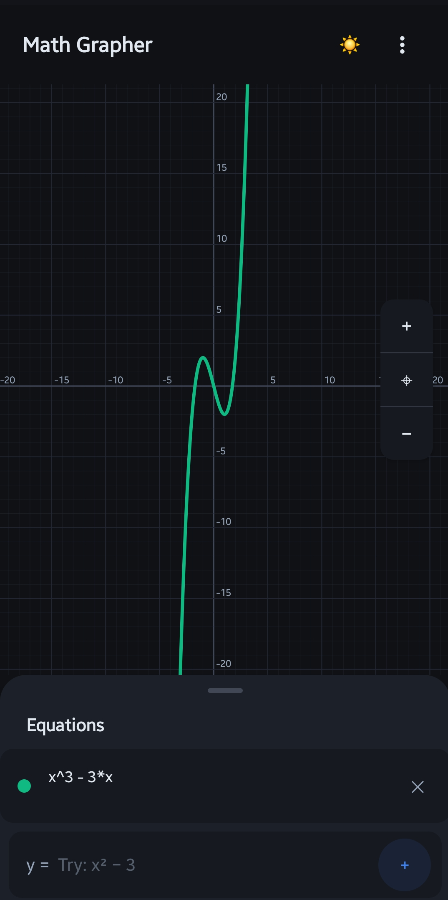
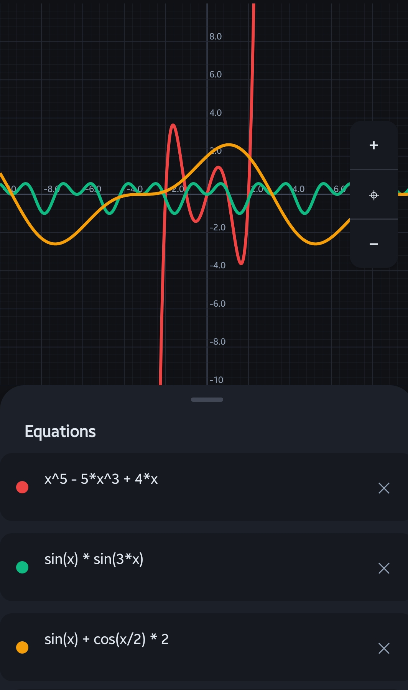

# Math Grapher 📈 (Drawmath)

[](https://github.com/prasad/Drawmath/actions/workflows/ci.yml)
**Version:** `v1.7.5`

Drawmath is a modern mathematical graphing application for Android designed to make exploring mathematics intuitive, visual, and interactive. It couples an ultra-fast custom math engine with a fluid Jetpack Compose UI for plotting explicit, implicit, parametric, and polar equations, inequalities, and complex functions.

The project is independently developed with an emphasis on simplicity, privacy, performance, and mathematical elegance. It also includes secure Firebase authentication and cloud profile synchronization to save user configurations across devices.

Created by **Prasad Dhodamani** — an independent project built with curiosity, mathematics, and code.

---

## 📸 Screenshots

| Single Parabola Graph | Multi-Equation View |
| :---: | :---: |
|  |  |
| *Single parabola graph ($y = x^2 - 3$)* | *Multi-equation view with sine, quadratic, and cubic* |

| Cubic Function Graph | Complex Equations |
| :---: | :---: |
|  |  |
| *Cubic function graph ($x^3 - 3x$)* | *Complex equations (polynomial + trig products)* |

---

## 🚀 Key Features

*   **Universal Equation Engine**: Plot explicit ($y = f(x)$), implicit ($x^2 + y^2 = 25$), parametric ($x = \cos(t), y = \sin(t)$), polar ($r = \sin(\theta)$), and inequalities ($y > x^2$) seamlessly without manual mode switching.
*   **High-Precision Custom Parser**: Built-in expression evaluation handles implicit multiplication, nested functions, negative odd roots (e.g. $x^{1/3}$), and both Radians and Degrees angle modes.
*   **Interactive Infinite Plane**: Smooth gesture-based panning, pinch-to-zoom, dynamic grid scaling, translucent axis halos, and coordinate coordinate readouts.
*   **Live Syntax Highlighting & Preview**: Real-time math syntax formatting as you type and an instant mathematical preview strip.
*   **Multi-Function Plotting**: Graph multiple equations concurrently with color-coded curves and dynamic equation chips.
*   **Modern Glassmorphic UI**: Jetpack Compose Material 3 dark-first interface with fluid animations, dynamic keyboard padding, and responsive bottom sheets.
*   **Cloud Sync & Authentication**: Optional Google Sign-In with Firebase Auth and Cloud Firestore sync for user profiles.

---

## 🛠️ Building from Source

### Prerequisites
*   **JDK 17** (e.g., Eclipse Temurin 17)
*   **Android SDK** (API 34 compileSdk / targetSdk, API 26 minSdk)
*   Gradle 8.x / 9.x (wrapper included)

### Setup & Firebase Configuration
For Firebase Auth and Firestore features, place your `google-services.json` inside the `app/` directory:
```bash
cp /path/to/your/google-services.json app/
```
*(Note: `google-services.json` is ignored by git to protect credentials. A dummy file can be used for offline unit testing).*

### Build Commands
```bash
# Grant execution permissions
chmod +x gradlew

# Run unit tests (math engine & parser)
./gradlew test

# Run Android lint checks
./gradlew lint

# Build debug APK
./gradlew assembleDebug

# Complete assemble and verification
./gradlew build
```
Built APKs will be located at `app/build/outputs/apk/debug/app-debug.apk`.

---

## 📥 Download Versions

Prebuilt APKs are available in the [`releases/`](./releases) directory:

*   **`v1.7.5` (Latest)**: Glassmorphic editable profiles, Coil image loading, Firestore cloud sync, animated sine-wave login background, and daily nudges.
*   **`v1.6.0`**: Parametric $t$ detection fixes, dark mode label visibility, expanded dialogs, and robust runtime error handling.
*   **`v1.5.0`**: Dual-input Parametric mode, graceful unbound parameter handling, negative odd root support ($x^{1/3}$), and Radian/Degree toggle.
*   **`v1.4.0`**: Live math preview strip, syntax highlighting in input bar, LazyRow equation chips, dynamic keyboard padding, and translucent axis halos.
*   **`v1.3.0`**: Universal Equation Support via Marching Squares for implicit equations, polar curves, and inequalities.
*   **`v1.2.0`**: Edge-to-edge layout, bounded graph clipping, negative grid scaling, and dark theme polish.
*   **`v1.1.0`**: Bottom sheet controls, side zoom controls, and updated color hierarchy.
*   **`v1.0.0`**: Initial release.

*To install, download the APK file to your Android device and open it. Ensure "Install from unknown sources" is enabled in your device settings.*

---

## 📄 License

This software is released under a Custom Proprietary License.

*   **Use:** Free for personal, non-commercial educational purposes.
*   **Commercial Use:** Commercial distribution or sale is **STRICTLY PROHIBITED** without an explicit Commercial License from Prasad Dhodamani.
*   **No Modifications:** You may NOT redistribute modified forks or derivative works.
*   **Attribution:** Provide proper attribution to Prasad Dhodamani when showcasing or reviewing this software.

See the [LICENSE](./LICENSE) file for complete terms.
